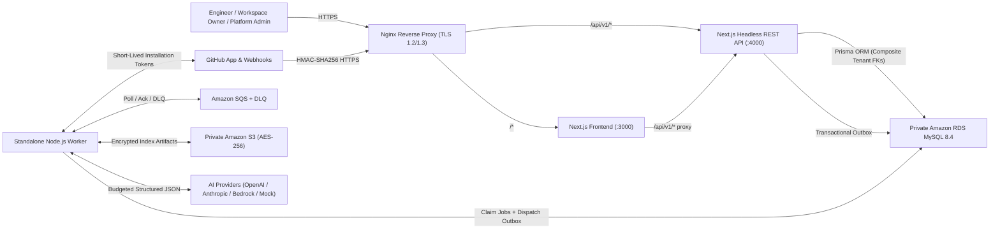
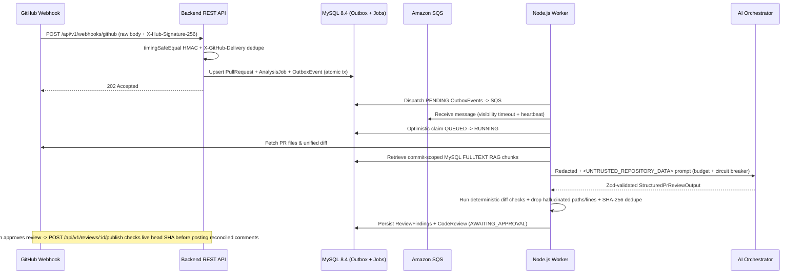

# CodePilot AI — System Architecture

## 1. Standalone Two-Repository Architecture

CodePilot AI is engineered as two strictly decoupled standalone repositories (never a monorepo):

1. **Backend API & Worker (`akintoyesodeinde/copilot-ai-backend`):** Headless Next.js App Router REST API (`:4000`) + standalone Node.js background worker (`src/worker/index.ts`), Prisma ORM, MySQL 8.4 LTS, Amazon SQS/DLQ, Amazon S3, Tree-sitter WASM AST engine, deterministic security scanners, architecture analyzer, and provider-agnostic AI orchestrator.
2. **Frontend Dashboard (`akintoyesodeinde/codepilot-ai-frontend`):** Standalone React 19 + Next.js App Router dashboard (`:3000`) communicating strictly over HTTP `/api/v1/*` with HttpOnly cookie sessions, automatic CSRF header handling, Monaco Editor, unified diff viewer, and React Flow interactive architecture graphs.

## 2. High-Level System Architecture Diagram

## 3. Automated Pull Request Review Sequence

## 4. Multi-Tenant & Security Invariants

- Every tenant-owned record carries `workspace_id` and composite foreign keys (`(workspace_id, id)`).
- Untrusted repository source code is **never** executed on the API or worker host (`web-tree-sitter` WASM parsing only; AI Test Studio sets `sandboxExecuted: false`).
- `PLATFORM_ADMIN` accesses only aggregated operational telemetry (`GET /api/v1/admin/overview`, `tenantCodeAccessGranted: false`) and is denied (`403 Forbidden`) private tenant repository code and vulnerability details.
