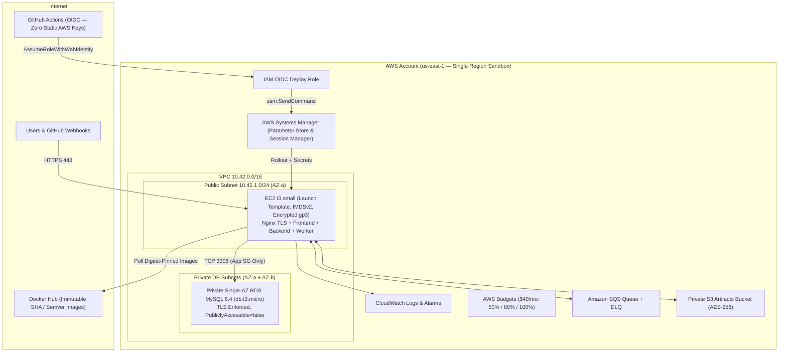

# CodePilot AI — AWS Sandbox Deployment Architecture

## 1. Network & Cloud Topology



## 2. CloudFormation Stacks (`infra/cloudformation/`)

1. **`01-network.yaml`:** VPC, IGW, 1 public subnet, 2 private DB subnets across 2 AZs, route tables, `AppHostSecurityGroup` (80/443 only; **no SSH port 22**), `RdsSecurityGroup` (TCP 3306 strictly from `AppHostSecurityGroup`).
2. **`02-data-and-messaging.yaml`:** Private encrypted Single-AZ RDS MySQL 8.4 `db.t3.micro` with `require_secure_transport=ON`, private AES-256 S3 bucket with Block Public Access + 90-day lifecycle, SQS Analysis Queue + DLQ (`maxReceiveCount: 3`), CloudWatch log groups (14-day retention), and RDS/SQS alarms.
3. **`03-iam-oidc-and-compute.yaml`:** GitHub Actions OIDC Provider + least-privilege deploy role scoped exclusively to `akintoyesodeinde/copilot-ai-backend` and `akintoyesodeinde/codepilot-ai-frontend`, EC2 instance profile role, EC2 Launch Template (`t3.small`, AL2023, IMDSv2 `HttpTokens: required`, encrypted 30 GB gp3), EC2 instance, Elastic IP, and EC2 status alarm.
4. **`04-budgets.yaml`:** AWS Budgets monthly `$40` USD cap alerting at 50%, 80%, 100% actual and 100% forecasted spend.

## 3. Windows PowerShell Provisioning Workflow (`infra/scripts/`)

```powershell
# 1. Verify AWS CLI identity & validate templates (read-only)
.\infra\scripts\01-verify-aws-cli.ps1

# 2. Preview deployment plan (dry-run by default)
$dbPass = Read-Host "Enter RDS Master Password (min 16 chars)" -AsSecureString
.\infra\scripts\02-plan-and-deploy.ps1 -AlertEmailAddress "you@example.com" -DbMasterPassword $dbPass

# 3. Provision ONLY after explicit review & approval
.\infra\scripts\02-plan-and-deploy.ps1 -AlertEmailAddress "you@example.com" -DbMasterPassword $dbPass -ApproveDeploy

# 4. Run live smoke tests
.\infra\scripts\03-smoke-test-sandbox.ps1 -BaseUrl "https://<EIP_OR_DOMAIN>"

# 5. Inspect inventory & spend
.\infra\scripts\04-inventory-and-cost-review.ps1

# 6. Tear down cleanly when demo concludes
.\infra\scripts\05-teardown-sandbox.ps1 -ConfirmTeardown
```

## 4. Environment Prerequisite Notice

During pre-deployment verification against local AWS CLI identity `arn:aws:iam::973429899833:user/stockexchange-admin`, AWS Organizations Service Control Policy `arn:aws:organizations::415709985211:policy/o-7gi5qmv2ql/service_control_policy/p-0nel9v63` explicitly denied `cloudformation:ValidateTemplate`. Before executing live provisioning, ensure your target AWS account/profile permits `cloudformation:*`, `ec2:*`, `rds:*`, `sqs:*`, `s3:*`, `iam:*`, `ssm:*`, `logs:*`, and `budgets:*`.
