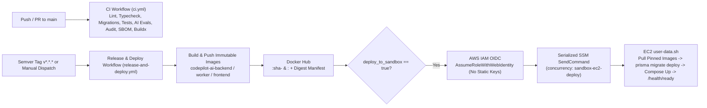

# CodePilot AI — CI/CD, Container Release & Serialized Deployment Pipeline

## 1. Release & Deployment Flow

## 2. Security Guarantees

- **Zero Static AWS Credentials:** GitHub Actions uses `permissions: { contents: read, id-token: write }` with `aws-actions/configure-aws-credentials` assuming `codepilot-ai-sandbox-github-oidc-deploy-role`.
- **Pinned Third-Party Actions:** Every external GitHub Action in `ci.yml` and `release-and-deploy.yml` is pinned to a full 40-character commit SHA.
- **Immutable Image Tags & Digests:** Every release tags images with both `sha-<shortsha>` and semver tags and uploads a JSON release manifest containing exact SHA-256 image digests and CycloneDX SBOMs.
- **Serialized Deployment Lock:** Both repositories share `concurrency: { group: sandbox-ec2-deploy, cancel-in-progress: false }` so backend and frontend rollouts never race on the single EC2 host.

## 3. Required GitHub Repository Secrets & Variables (When Enabling Live Release/CD)

| Kind     | Name                      | Purpose                                                  |
| -------- | ------------------------- | -------------------------------------------------------- |
| Secret   | `DOCKERHUB_USERNAME`      | Docker Hub namespace for image publishing                |
| Secret   | `DOCKERHUB_TOKEN`         | Scoped Docker Hub personal access token                  |
| Variable | `AWS_DEPLOY_ROLE_ARN`     | ARN output `GithubActionsDeployRoleArn` from Stack 03    |
| Variable | `AWS_REGION`              | Target AWS region (default `us-east-1`)                  |
| Variable | `SANDBOX_EC2_INSTANCE_ID` | EC2 instance ID output `AppHostInstanceId` from Stack 03 |
