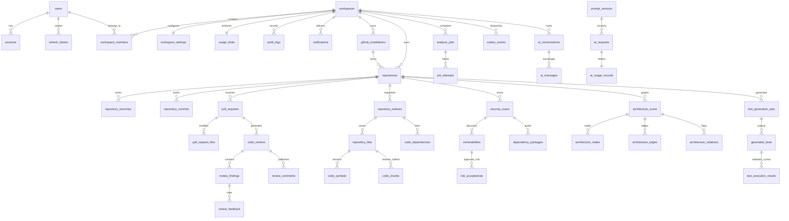

# CodePilot AI — MySQL 8.4 Entity-Relationship Diagram (43 Tables / 15 Migration Groups)

All schema changes are governed by 15 ordered, version-controlled Prisma SQL migrations (`20261124000100_001_identity` through `20261125001500_015_performance_and_integrity`), verified with zero drift in CI (`prisma migrate diff --exit-code`).

## Migration Group Inventory

| Group | Migration Directory                            | Purpose                                                                                                   |
| ----- | ---------------------------------------------- | --------------------------------------------------------------------------------------------------------- |
| 001   | `20261124000100_001_identity`                  | `users`, `user_identities`, `sessions`, `refresh_tokens`                                                  |
| 002   | `20261124000200_002_multi_tenancy`             | `workspaces`, `workspace_members`, `workspace_invitations`                                                |
| 003   | `20261124000300_003_authorization`             | `roles`, `permissions`, `role_permissions`                                                                |
| 004   | `20261124000400_004_application_operations`    | `workspace_settings`, `usage_limits`, `audit_logs`, `notifications`                                       |
| 005   | `20261124000500_005_repository_foundation`     | `github_installations`, `repositories`, `repository_branches`, `repository_commits`                       |
| 006   | `20261125000600_006_github_and_pull_requests`  | `github_webhook_events`, `pull_requests`, `pull_request_files`                                            |
| 007   | `20261125000700_007_code_intelligence`         | `repository_indexes`, `repository_files`, `code_symbols`, `code_chunks` (`FULLTEXT`), `code_dependencies` |
| 008   | `20261125000800_008_job_processing`            | `analysis_jobs`, `job_attempts`, `outbox_events`                                                          |
| 009   | `20261125000900_009_ai_infrastructure`         | `prompt_versions`, `ai_requests`, `ai_usage_records`                                                      |
| 010   | `20261125001000_010_automated_reviews`         | `code_reviews`, `review_findings`, `review_comments`, `review_feedback`                                   |
| 011   | `20261125001100_011_security_intelligence`     | `security_scans`, `vulnerabilities`, `dependency_packages`, `risk_acceptances`                            |
| 012   | `20261125001200_012_architecture_intelligence` | `architecture_scans`, `architecture_nodes`, `architecture_edges`, `architecture_violations`               |
| 013   | `20261125001300_013_ai_conversations`          | `ai_conversations`, `ai_messages`                                                                         |
| 014   | `20261125001400_014_automated_testing`         | `test_generation_jobs`, `generated_tests`, `test_execution_results`                                       |
| 015   | `20261125001500_015_performance_and_integrity` | Retention expiry columns (`retention_expires_at`) and composite performance indexes                       |
